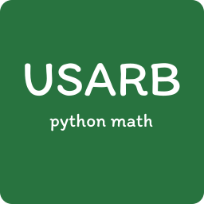

# python-math

## Project Description

python-math is a collection of twelve applied Mathematics and algorithmic problems, each solved by an independent Python program, intended for the study of the application of the Python language and fundamental algorithms in the field of computer science.

The problem set covers the following areas:

1. Combinatorics and simulated enumeration
2. Numerical and exact linear algebra
3. Number theory
4. Numerical optimization
5. Computational geometry
6. Set algebra
7. Graph theory

Implemented in code by student Marian Tocana and supervised by professor Vitalie Ticau.
